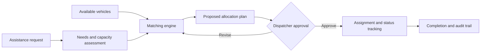
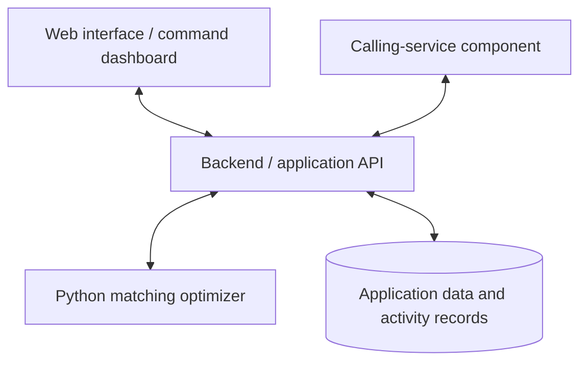

# Member Roles

### Aayush Pal - Simulations, the Langevin Modelling, Phone Mesh and Federated Learning. Website Backend. 
### Sainath Kesireddy - Simulations, Drift-Diffusion, Adaptive Large Neighborhood Search. Website Backend. 
### Prayan Agarwal - Website Frontend, Website Backend.
### Muhammad Fauzan - Website Frontend, Website Backend.
### Muhammed Adbdul Rahman - UI/UX, Website Frontend

# Standard Response

### Live at https://web-production-d0f204de.up.railway.app/dashboard
### From urgent requests to coordinated evacuations.

**Standard Response** is an evacuation-coordination platform designed to help emergency teams identify who needs assistance, understand individual transport requirements, and organize available vehicles into an actionable response plan.

Instead of leaving dispatchers to reconcile disconnected requests, vehicle availability, and accessibility needs by hand, Standard Response brings them into one operational workflow: **collect → prioritize → match → approve → track → review.**

> **Project status:** Hackathon prototype and decision-support demonstration. Vehicle acceptance and response progression can be simulated. The project is **not** a deployed emergency dispatch network or a substitute for official emergency services.

---

## The problem

During an evacuation, finding a vehicle is only part of the challenge. Coordinators must determine **who needs help, what kind of assistance they require, which resources are suitable, and whether help has actually arrived**—often while information is changing quickly.

Several gaps make that difficult:

- **Fragmented intake:** Requests can arrive through separate channels and become difficult to consolidate or review.
- **Invisible accessibility needs:** A vehicle with spare seats is not necessarily suitable for a person who requires mobility assistance or specific transport accommodations.
- **Constrained resources:** Available seats, vehicle capabilities, and competing requests must all be considered when assigning transportation.
- **Manual coordination:** Repeated handoffs and status checks can slow the movement from a reported need to an approved plan.
- **Weak operational visibility:** Teams need a shared understanding of which requests are unassigned, assigned, accepted, or complete.
- **Limited accountability:** Without a consistent decision record, it is difficult to reconstruct what was assigned, approved, changed, or left unresolved.

**The underlying problem is not simply a shortage of data. It is the lack of a clear, coordinated way to turn that data into decisions.**

## Our solution

Standard Response is built around a simple principle: **the right vehicle should reach the right people through a plan that human coordinators can understand and control.**

The platform combines structured assistance requests with information about available vehicles. A matching component proposes allocations while considering passenger capacity and relevant accessibility requirements. A dispatcher reviews the proposed plan before it becomes an assignment. The interface then follows each request through subsequent response states and records important actions for review.

This is **decision support, not autonomous emergency command**: recommendations assist operators; people remain responsible for approving operational actions.

## How it works

**1. Capture the need.** Record a household or individual assistance request and its transportation requirements in a consistent format.

**2. Build a resource picture.** Review vehicles and the passenger capacity and assistance capabilities available for assignment.

**3. Generate an allocation plan.** Use capacity-aware matching to propose suitable vehicles rather than assigning resources solely on availability.

**4. Keep the dispatcher in control.** Present the recommended matches for human review and approval, with room for operational judgment.

**5. Follow through to completion.** Track assignment progress, simulate driver acceptance for demonstration, mark requests resolved when appropriate, and preserve an activity record.

## Core functionality

| Capability | What it delivers |
| --- | --- |
| **Centralized assistance intake** | One place to record and manage evacuation assistance requests. |
| **Accessibility-aware request profiles** | Captures transport needs that affect whether a vehicle is suitable. |
| **Vehicle and capacity management** | Keeps resource availability and passenger limits visible during allocation. |
| **Constraint-aware matching** | Produces proposed assignments based on available capacity and relevant requirements. |
| **Human approval workflow** | Separates system recommendations from dispatcher-authorized actions. |
| **Assignment lifecycle tracking** | Makes pending, assigned, accepted, and completed states easier to follow. |
| **Driver-response simulation** | Demonstrates the operational handoff without requiring live dispatch integrations. |
| **Audit and activity history** | Provides a trace of actions and status changes for review. |
| **Modular application design** | Separates the user interface, backend, matching logic, and calling-service component. |

## Why Standard Response is different

### 01 — Compatibility over convenience

A nearest-or-first-available approach can overlook the requirements that determine whether a journey is feasible. Standard Response places **capacity and accessibility compatibility** at the center of assignment planning.

### 02 — Recommendations with human accountability

Automatic suggestions can reduce repetitive coordination work, but emergency decisions require context and oversight. Standard Response treats **dispatcher approval as a deliberate step**, not an obstacle to bypass.

### 03 — An operational workflow, not just a dashboard

The platform connects intake, matching, approval, status progression, and review. This makes it possible to understand **what still needs action**, not merely what appears on a screen.

### 04 — Explainable, inspectable coordination

Resource recommendations and activity records create a foundation for reviewing allocation decisions, spotting unresolved requests, and improving future workflows.

### 05 — Built to evolve beyond a demo

The codebase separates the application layers so production-grade communications, mapping, authentication, and persistent integrations can be introduced without redefining the core coordination model.

## System architecture

The project package contains these major areas:

- **Frontend:** operator-facing intake, resource review, assignment, and tracking interfaces.
- **Backend:** application workflows and coordination between interface, optimizer, and services.
- **Python optimizer:** the matching component used to propose feasible vehicle assignments.
- **Calling service:** a separate component intended for communications-related workflows; production call delivery is **not assumed**.
- **Assets and tests:** supporting project resources and validation material.

The diagrams describe the intended functional boundaries rather than guaranteeing a particular cloud topology, database, or third-party integration.

## Technology and implementation approach

Standard Response is organized as a **web application with a Python-based matching component**. Its core optimization concern is operational feasibility: matching assistance needs to available resources under capacity and suitability constraints.

The prototype emphasizes:

- **Modularity:** clearer separation of user experience, orchestration, and assignment logic.
- **Human-in-the-loop control:** an approval checkpoint before dispatch decisions are treated as confirmed.
- **Traceability:** events and state transitions suitable for demonstration and review.
- **Reproducibility:** a simulation path that does not depend on access to a real emergency network.
- **Integration readiness:** space for future communication, routing, and public-sector systems, subject to validation and authorization.

> The archive's exact framework versions, environment variable names, and launch scripts should be taken from its source files. This README deliberately avoids publishing unverified commands or claiming integrations are live.

## Getting started

1. **Extract the project archive** and open it in your preferred code editor.
2. **Review the included `START-HERE.md`** for the repository-specific prerequisites and startup commands.
3. **Configure environment variables** only for the services you actually enable. Keep API keys out of source control and public screenshots.
4. **Start the backend and frontend** using their respective project scripts.
5. **Launch the demo workflow** using fictional request and vehicle data, then inspect the proposed matching plan, approval flow, and status history.
6. **Run the provided tests** before presenting or making deployment changes.

**Important:** Do not enter real residents' names, phone numbers, precise locations, medical details, or other sensitive information into a public or unverified demo environment.

## Expected impact

Standard Response aims to improve the **quality, speed, and visibility of evacuation coordination**. These are intended outcomes, **not measured deployment results**.

| Impact area | Intended improvement | How to evaluate it |
| --- | --- | --- |
| **Response coordination** | Less manual work between request intake and assignment planning | Time from request creation to approved allocation |
| **Accessibility and inclusion** | More requests matched to appropriately equipped transport | Share of assignments meeting recorded accessibility requirements |
| **Resource utilization** | Better use of limited vehicle capacity | Seats utilized, unassigned demand, and rejected matches |
| **Operational clarity** | Fewer requests lost between handoffs | Unresolved-request count and assignment-state completeness |
| **Accountability** | Easier reconstruction of decisions and changes | Percentage of key actions recorded with timestamps and status |
| **Continuity of service** | Faster identification of requests needing reassignment | Time spent in pending or failed-assignment states |

A meaningful next-stage evaluation would compare **manual coordination against the same test workload using Standard Response**, holding request volume, vehicle availability, and accessibility constraints constant. Results should include failure cases, not just successful matches.

## Safety, privacy, and responsible deployment

Evacuation coordination is safety-critical. A prototype must not be mistaken for an authorized response system.

- **Human oversight:** recommendations require qualified operator review.
- **Simulation boundaries:** driver acceptance, arrivals, and completion states in the demo do not represent verified real-world events.
- **Privacy by design:** collect only necessary personal information; production use would require appropriate consent, access controls, retention policies, and security review.
- **Constraint visibility:** vehicle capacity and accessibility information must be current and verified before operational use.
- **Graceful degradation:** production systems need procedures for outages, conflicting reports, incomplete data, and manual override.
- **No unsupported emergency claims:** the prototype is not connected to real dispatch networks and should not be used to coordinate real emergencies.

## Current scope and limitations

The demonstration supports an end-to-end concept for intake, assignment planning, dispatcher decisions, simulated response progression, and auditability. It **does not establish**:

- verified real-world vehicle availability or positioning;
- live emergency-service or government-system connectivity;
- confirmed telephone calls or messages to residents and drivers;
- real-time road, hazard, or shelter data;
- operationally validated travel-time estimates;
- audited optimization performance under large-scale emergencies; or
- compliance with public-sector security, accessibility, or procurement requirements.

Any production deployment would require extensive field testing, integration agreements, security engineering, and approval by the relevant emergency-management authorities.

## Roadmap

- [ ] Add authenticated multi-user roles for dispatchers, supervisors, and response teams.
- [ ] Integrate consent-aware communication providers with delivery confirmations.
- [ ] Connect verified routing, road-closure, and hazard information.
- [ ] Improve optimization with travel time, priority, service windows, and reassignment constraints.
- [ ] Add durable shared storage, event streaming, and reliability monitoring.
- [ ] Support multilingual and accessible request-intake channels.
- [ ] Evaluate allocation fairness, performance, and resilience under stress tests.
- [ ] Conduct controlled pilots with appropriate agencies before any operational deployment.

## The vision

In a crisis, every request deserves more than a record in a system. It needs a **clear next action, a suitable resource, an accountable decision-maker, and a visible path to resolution**.

**Standard Response turns fragmented evacuation information into a coordinated plan—helping responders move from knowing who needs help to organizing how help can reach them.**

---

*Built as a government and public-systems hackathon prototype. Demonstration data and simulated actions are not evidence of real-world emergency readiness.*
